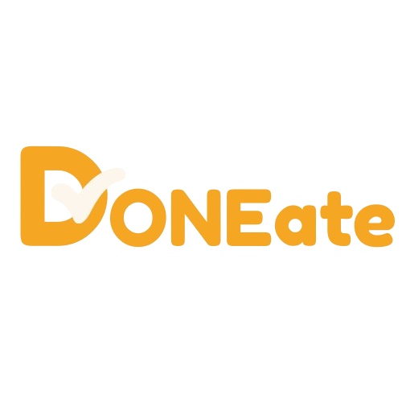

<p align="center">
  
</p>

# DONEate — Donation Tracker

DONEate is a web application for managing donations, community requests, and the allocation of essential supplies. It was developed as the **final project for the Information Management course** by **Triselle Bernabe, Matan Exconde, and Kim Magan**.

## Project Members

- Triselle Bernabe
- Matan Exconde
- Kim Magan

## Project Overview

DONEate connects donors, organizers, and community representatives in one donation management workflow. Donors contribute supplies, representatives communicate community needs, and organizers manage campaigns and allocate available inventory.

The project applies relational database concepts through linked records for users, donations, requests, campaigns, and inventory. Reports summarize donation activity and supply needs using SQL queries, pandas, and Matplotlib.

## Features and User Roles

| Role | Features |
| --- | --- |
| Donor | Browse organizers and campaigns, record donations, track campaign allocations, read organizer updates, and leave ratings and feedback. |
| Organizer | Review community requests, create campaigns, allocate inventory, send donor updates, and view reports. |
| Community representative | Browse organizers and submit requests for essential supplies on behalf of a community. |

Additional features include:

- Registration and login for all three roles.
- Donation and request forms for rice, clothes, canned goods, and medical kits.
- Inventory allocation that prioritizes urgent campaigns, then older campaigns, and splits inventory when only part of a donation is needed.
- Automatic campaign completion when all required item quantities have been allocated.
- Reports covering organizer donation counts, available allocated items, donor totals, frequently requested items, and campaign status counts.

## Technology Stack

| Technology | Purpose |
| --- | --- |
| Python | Application language. |
| Flask and Jinja | Routing, sessions, and HTML templates. |
| Flask-SQLAlchemy and SQLAlchemy | Database models, relationships, and SQL queries. |
| SQLite | Local relational database storage. |
| pandas | Preparing report data. |
| Matplotlib | Generating report charts. |
| HTML, CSS, and JavaScript | Page layouts, styling, and browser interactions. |
| Docker and Gunicorn | Container packaging and serving the Flask application. |

## Local Installation and Setup

### Prerequisites

- Python and pip. The Docker image uses Python 3.12.
- A local copy of this repository.
- Optionally, the SQLite CLI for inspecting the database.

Run all commands from the project root, which contains `app.py` and `requirements.txt`.

### Windows (PowerShell)

Create a virtual environment and install the dependencies:

```powershell
python -m venv .venv
.\.venv\Scripts\python.exe -m pip install -r requirements.txt
```

Ensure the database directory exists, then start the application:

```powershell
New-Item -ItemType Directory -Force instance | Out-Null
.\.venv\Scripts\python.exe app.py
```

### macOS / Linux

```bash
python3 -m venv .venv
.venv/bin/python -m pip install -r requirements.txt
mkdir -p instance
.venv/bin/python app.py
```

Open [http://localhost:5000](http://localhost:5000). Select **Start giving** or **Log in** to reach the login page, then choose **SIGN UP** to create an account and select a role.

The commands use the virtual environment's Python directly, so activation is optional. Starting with `app.py` enables Flask's development server and debug mode.

## Running with Docker

Install and start Docker Desktop with Linux containers enabled, or use a Linux Docker Engine.

Build the image from the project root:

```powershell
docker build -t donation-tracker .
```

### Use the existing database

Ensure `instance/db.sqlite` is present, then run this command in PowerShell:

```powershell
docker run --rm --name donation-tracker -p 5000:5000 -v "${PWD}/instance:/app/instance" donation-tracker
```

For macOS / Linux:

```bash
docker run --rm --name donation-tracker -p 5000:5000 -v "$(pwd)/instance:/app/instance" donation-tracker
```

Open [http://localhost:5000](http://localhost:5000). The container serves the app with Gunicorn. The bind mount keeps database changes in your local `instance` folder after the container stops; the database itself is excluded from the image.

### Use a separate database

To start with an empty database stored in a persistent Docker volume:

```powershell
docker run --rm --name donation-tracker -p 5000:5000 -v donation-tracker-data:/app/instance donation-tracker
```

The app creates the tables automatically. A new database does not include users, organizers, campaigns, or item records. Follow the item catalog requirements below before using donation and request forms.

Press `Ctrl+C` in the terminal running the container to stop it. Alternatively, run `docker stop donation-tracker` in another terminal. The bind-mounted data or named volume remains available for the next run.

## Database

The application stores its data in **`instance/db.sqlite`**. Keep the `instance` directory in place before startup: the reporting code opens the database during application import. Run the app from the project root so the reporting queries and application models use the same database.

### Main entities

| Area | Tables |
| --- | --- |
| Accounts and communities | `Users`, `Donors`, `Organizers`, `Representatives`, `Communities` |
| Campaigns and needs | `Campaigns`, `CampaignDetails`, `ItemList` |
| Donations and allocation | `Donations`, `DonationDetails`, `Inventory` |
| Community requests | `Requests`, `RequestDetails` |
| Communication | `Feedbacks`, `Updates` |

Donations link donors to organizers, with item quantities recorded in donation details and inventory. Inventory can then be assigned to a campaign. Campaign details and request details link individual item types to the quantities needed.

### Item catalog requirements

There is no automatic seed script. When using a fresh database, populate `ItemList` with the following IDs and names before recording donations or requests. The request forms use these fixed IDs, while donation processing looks up items by name.

| ItemID | ItemName |
| --- | --- |
| 1 | Rice |
| 2 | Clothes |
| 3 | Canned Goods |
| 4 | Medical Kits |

Create organizer accounts through registration so donors and representatives have an organizer to select. Existing databases may already contain this data; inspect them before making changes.

### Inspect with the SQLite CLI

With `sqlite3` installed and available on your PATH, open the database from the project root:

```powershell
sqlite3 instance/db.sqlite
```

At the SQLite prompt:

```sql
.tables
.schema Donations
.headers on
.mode column
SELECT * FROM ItemList;
SELECT DonationID, DonorID, OrganizerID, Date FROM Donations LIMIT 10;
.quit
```

SQLite shell commands such as `.tables` do not need a semicolon; SQL statements do. Stop the app before copying the database for a backup.

## Project Structure

```text
donation-tracker/
├── app.py              # Flask routes, authentication, and allocation workflow
├── extensions.py       # Shared SQLAlchemy instance
├── models.py           # Database models and relationships
├── reports.py          # SQL queries and report data preparation
├── requirements.txt    # Python application dependencies
├── Dockerfile          # Python image and Gunicorn startup
├── .dockerignore       # Files excluded from the Docker build context
├── templates/          # Jinja HTML templates
├── static/             # Stylesheets, JavaScript, fonts, and images
├── instance/
│   └── db.sqlite       # SQLite database, stored outside the Docker image
├── dataframe.py        # Standalone data exploration script
└── delete_contents.py  # Database cleanup utility; deletes table contents
```

## Current Limitations

- This is an academic project. Passwords are currently stored as plain text, the session secret is hardcoded, and protected routes do not consistently enforce authentication and role permissions. These need to be addressed before public deployment.
- Item types and their IDs are fixed in the current forms. A fresh database requires manual catalog setup.
- Table creation uses `db.create_all()`; there is no migration framework for updating existing database schemas.
- Tracking shows recorded inventory allocations and organizer updates. It does not verify physical delivery or provide shipment tracking.
- The local entry point runs in debug mode. Docker uses Gunicorn, but containerizing the app does not resolve its authentication or data validation limitations.
